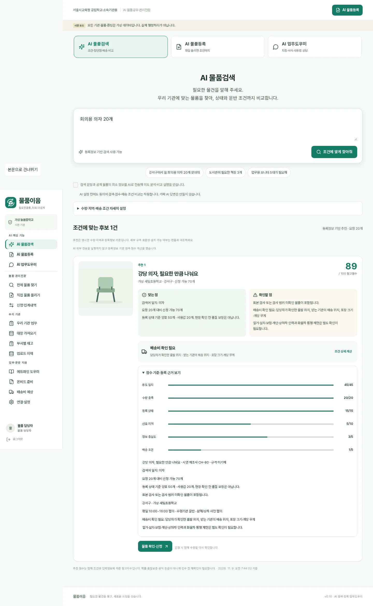
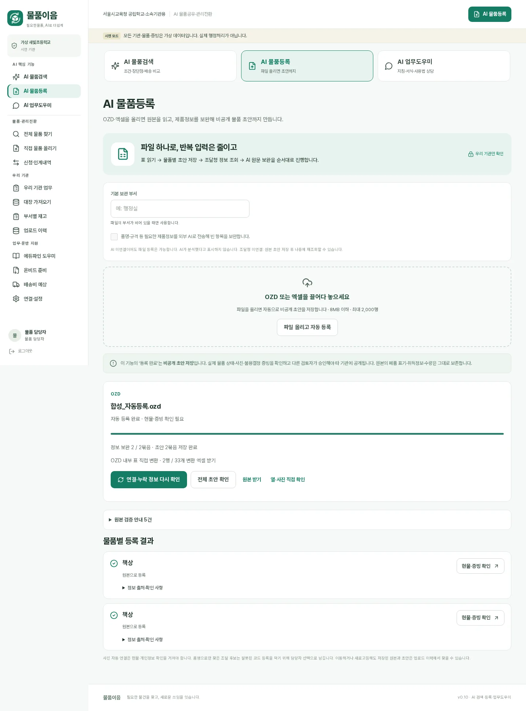

# v0.10 AI 핵심 기능 검증

기반: PR #2 `12e5211756d938bcc7d3124de06b03d246023276`. Node24/Linux/Chromium 합성 테스트 환경.
실제 NAS·운영 DB·실제 API 키·비공개 RAG 자료팩은 이 환경으로 옮기거나 수정하지 않았다.

## 구현 단위 검증
기존 121개 테스트에 AI 핵심 기능 21개 추가(총142개).
- 기존 DeepSeek 키·모델 재사용, 신규 제품정보 전송 승인 분리, 동의 없으면 네트워크 0
- 실제 게시된 타 기관 물품만 검색, 비공개/자기기관/활성해제/예약 소진 제외
- 검색 중 상태 변경 재검사, 출발 위치 공개 미확인시 다른 기관 API에서 제외
- 추천 점수 합계100, 부족 수량·제외 표현, 없는 물품을 생성하지 않음
- AI 근거 ID/물품 ID/근거 없는 수치 및 원문에 없는 제조사·모델 차단
- 배송 필수정보 없으면 미산정, 좌표/규격 있으면 기존 산식으로 예시금액 표시
- OZD 내부 변환→자동 초안→원본 보존·중복방지·이력 재개
- 조달 정확번호의 빈칸만 보완, 유사명 후보는 미확정, 폐품/취득정보/수량 유지
- 일시 API 실패 후 재시도·사용자 수정과 동시 분석의 충돌 방어
- 기관별 접근권한·로그인·CSRF·업무역할·입력범위

## 브라우저 검증
기존 23개 업무 시나리오를 유지하고 신규5개 추가(이전 PR의 ‘오늘 할 일’ 전용3개는 새 화면 검증으로 대체).
전체 **28개 통과**. 신규 AI5개 단독 재실행도 통과했다.
1. AI 중심 진입·상단3메뉴·근거접기·점수/장단점/배송정보 없음
2. 합성 OZD 드래그만으로 자동 초안2묶음, 재업로드 멱등, 원본 폐품 보존
3. 엑셀 드래그만으로 원본 초안 자동 생성
4. 없는 물품·잘못된 파일·모바일390px 넘침 없음
5. DeepSeek/조달청/주소/도로경로 **테스트 대역**으로 외부 연계 접점과25km 배송 산식 검증

새 테스트의 OZD와 기존 수동등록 테스트가 같은 합성 원본을 공유해 ‘기등록’ 응답이 발생하던 것을
새 기능 전용 합성 원본으로 분리했다. 멱등 검사를 완화하거나 서버에 가짜 성공을 넣지 않았다.
주소 입력의 접근성 이름이 버튼과 합쳐지던 문제는 명시적 aria-label로 수정했다.

## 화면
실제 실행한 합성 앱에서 캡처했다. 실제 외부 모델의 품질을 보여주는 자료는 아니다.

로컬 화면 접근 도구 제한으로 픽셀 단위 육안 검수는 완료하지 못했다. Playwright DOM·행동·캡처·모바일 가로넘침을 검사했고,
사용자 운영환경의 최종 육안 검수는 Codex 인계에 포함했다.

## 외부 실접속과 남은 검증
- 실제 DeepSeek 응답/모델 지원, 조달청 키 승인·실제 응답, 카카오 경로·주소 키는 미검증이다.
- 실제 사용자 파일·실물 상태·기관 보안승인·운영배포·업체 운송단가는 별도 검증해야 한다.
- 추천 점수는 초기 참고기준이며 객관적 품질 확률/최저가 보장이 아니다. 실제 질의 평가를 거쳐 가중치를 조정할 수 있다.
- 기본 배송단가는 시연 가정이다. 배차·예약·결제는 수행하지 않는다.
- 법령/지침 RAG는 기존 자료와 권한 정책을 그대로 사용하며 새 프로그램 설명3개만 추가했다.
- 이번 구현은 실시간 구조화 검색+LLM 근거 설명 RAG이다. 벡터 임베딩 DB를 구축한 것으로 보고하지 않는다.
