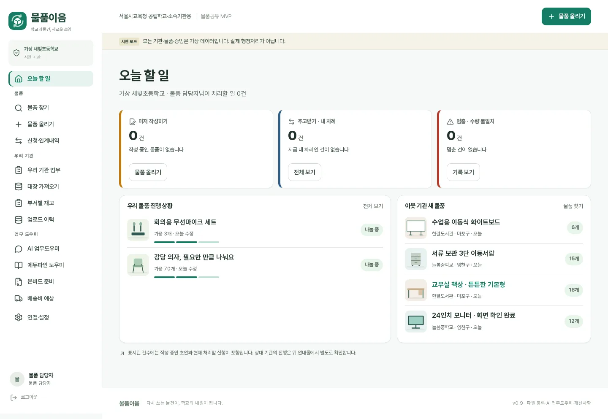
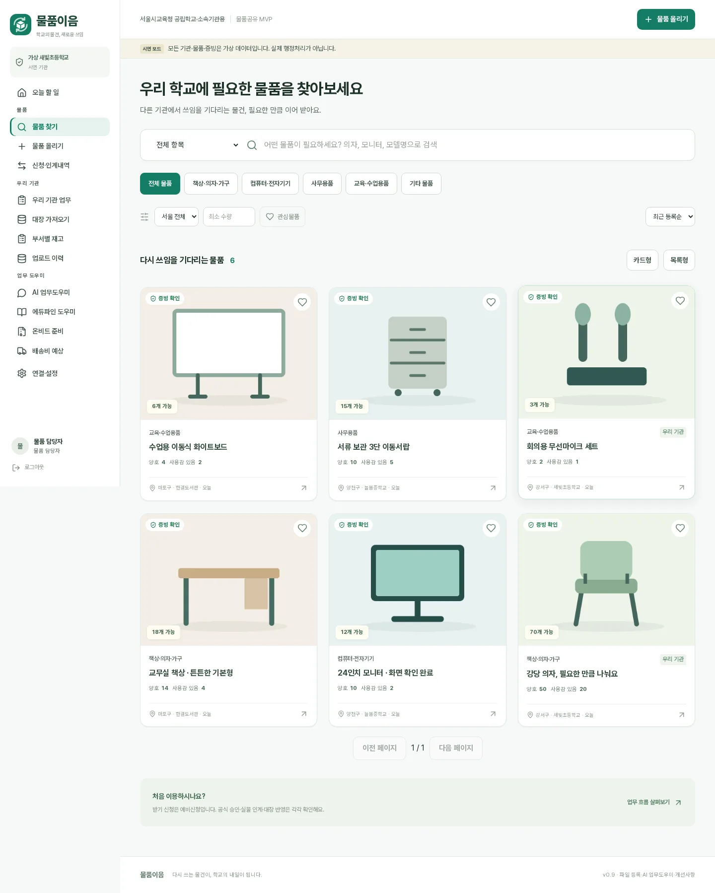
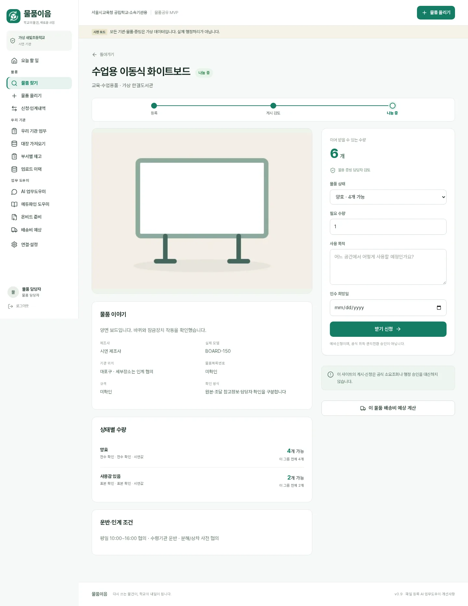
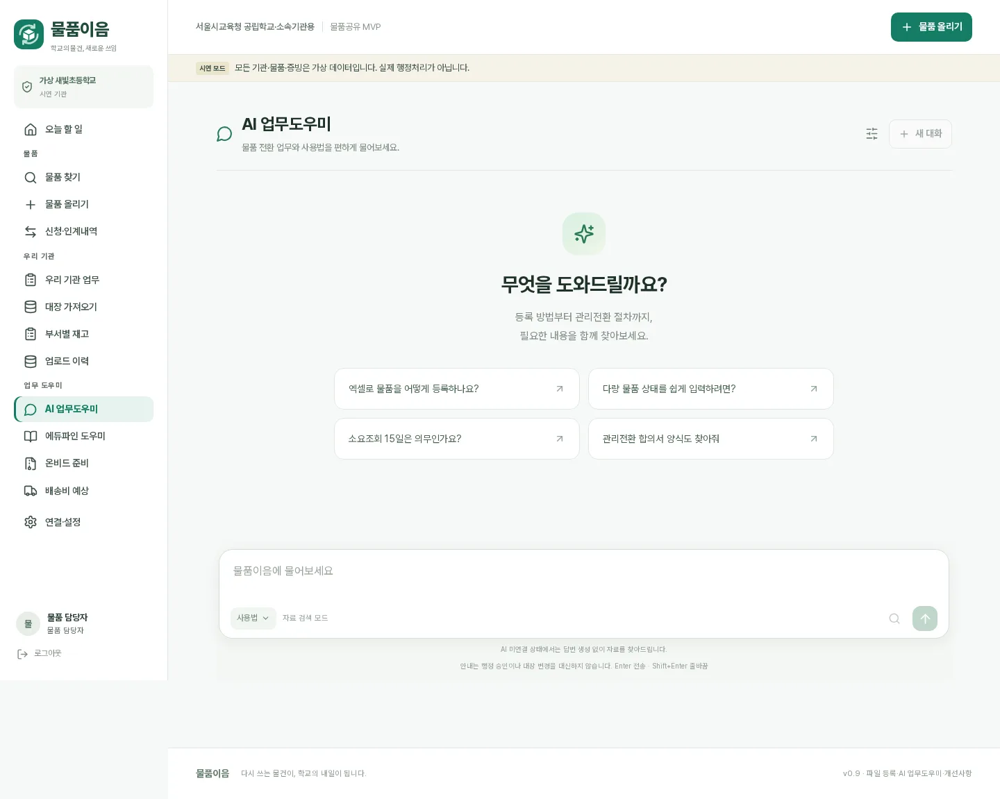
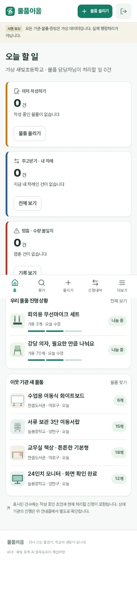
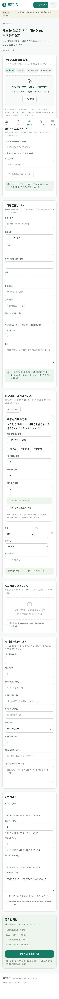

# 물품이음 v0.9 현재 main에 맞춘 디자인 적용 (2026-11-09)

원본 디자인 PR: https://github.com/h19h29-design/trade/pull/1
원본 시안 head: `design/v09@2def121d09658565953fbb00709dc2f67146a67f`
포팅 기준: `main@01b4ecca51d09e20e26794df6ce02c0c62d83baf`.

## 무엇을 바꿨나
- 기관 업무 담당자의 로그인 후 홈은 **오늘 할 일**. 작성 중 초안·자기 차례의 신청·수량 불일치를 한눈에 보여준다.
- 이전 PR에서 확인된 **이어서 작성 링크 오류**, **작성 초안을 누락한 총계**, **무제목 사이드바 그룹 중복 키**, **이웃 기관 목록 오류 숨김**을 수정했다.
- 물품 진행상태는 **등록 → 게시 검토 → 나눔 중**(3단계), 별도 신청/인계는 **신청 → 예비 배정 → 인계 → 인수 → 완료**(5단계)로 표시한다. 각각 실제 서버 업무 상태만 근거로 삼으며, 공식 승인이나 행정처리를 완료한 것으로 표시하지 않는다.
- 좌측 메뉴를 홈·물품·우리 기관·업무 도우미·연결/설정으로 그룹화했고, 모바일 하단에 홈 탭을 추가했다. 390px 폭에서 가로 넘침을 검사했다.
- Pretendard 자체 호스팅, 한국어 줄바꿈, 작은 글자 대비, 로고 B, 카드 및 물품 상세 우선순위를 원본 시안에서 채택했다.
- **기존 v0.9의 OZD 직접 XLSX 변환·드래그 업로드·조달 정보 보완·AI 업무도우미의 접힌 출처·RAG·기관별 권한·전환 업무 흐름은 보존했다.** 이번 PR에는 새 서버 API/DB 변경이 없다.
- 원래 디자인 PR의 `Feedback` 기능은 현재 main에 없는 별도 개발기능이므로 의도적으로 함께 가져오지 않았다. 다른 브랜치의 미병합 변경을 몰래 포함하지 않는다.

## 시안과 실제 코드 스크린샷
*데스크톱·모바일 2026-11-09, 공개 합성 시연 데이터, 비공개기관 실데이터 사용 안 함.*

| 화면 | 미리보기 |
|---|---|
| 로그인 후 오늘 할 일 |  |
| 물품 찾아보기 |  |
| 물품 상세 |  |
| AI 업무도우미 |  |
| 모바일 홈 |  |
| 모바일 물품 업로드 |  |

별도의 공개 실서버 배포가 아니라 실험용 서버에서 캡처했으며, 실제 NAS 서비스는 수정하지 않았다.

## 검증 및 병합 제한
- `npm ci`, `npm test`, `npm run build`, `npm audit`, `npm run test:e2e` 통과 여부를 PR CI에서 확인한다.
- 별도 합성 demo DB에서 프런트엔드 실제 흐름을 검증한다. 외부 조달청·DeepSeek 실키는 보내거나 시험하지 않는다.
- 브라우저의 Blob 다운로드 이름은 일부 headless Chromium에서 `download`로 나올 수 있다. 회귀 테스트는 CSV BOM·행/식별번호를 실제로 검사한다.
- PR은 `main` 대상으로 열고 **사용자 요청 없이 병합·운영 배포하지 않는다.**
