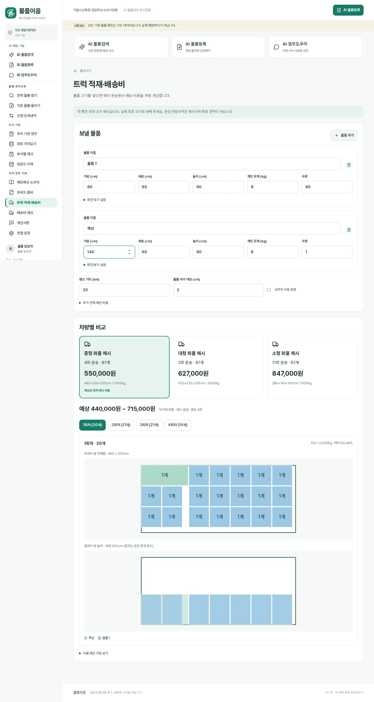
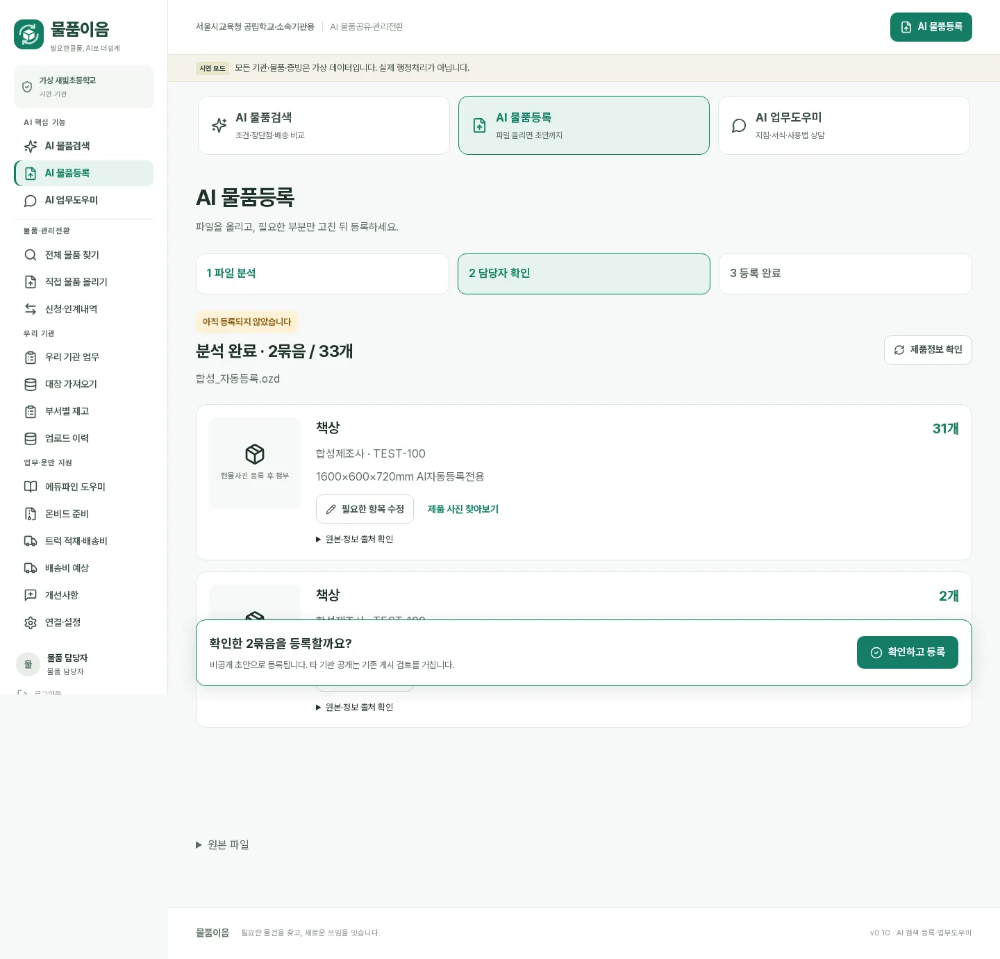

# v0.11 검증 기록

기준 `main@c847085888b0cba06e0544ba820b913f9dc08da0`, Node24 Linux/Chromium 합성 환경, 2026-11-10.

## 완료한 검사
- `npm ci`: 잠금 의존성 설치 완료.
- `npm test`: **181개 통과** (기존 167개 + 적재/미리보기 확인 12개 + 실제 검수 보강 2개).
- `npm run build`: TypeScript 및 Vite 프로덕션 빌드 통과.
- `LANG=C.UTF-8 LC_ALL=C.UTF-8 npm run test:e2e`: **35개 통과**.
- `npm audit --audit-level=low`: 검사 시 알려진 취약점 0건.
- `git diff --check`: 통과.

신규 테스트는 50개의 재현 가능한 혼합 물품 사례에서 적재함 경계/높이/중량/개수보존/평면 비중첩을 확인한다.
회전·쌓기 확인·무거운/큰 물품 거부·한도·미리보기 절삭과 전체 비용 일치도 검사했다.
등록은 자동분석·조달/AI 보완·부분수정 단계에서 실제 물품0건, 확인 후에만 등록되며 폐품/취득단가/대장 수량을 보존한다.
HTTP 인증·CSRF·기관격리·낡은 버전·중복확인·동시원본 등록·미리보기 만료 후 안전한 재개도 검사했다.

## 화면·환경 보정
원본 다운로드 링크를 설명 접기 안으로 옮겼으므로 브라우저 테스트도 실제 접기 버튼을 먼저 연 뒤 링크를 조작하게 수정했다.
이전 개선사항 첨부 테스트는 비 UTF-8 Linux 환경에서 한국어 다운로드 이름이 `download`로 나타났다.
UTF-8 로케일에서 원래 파일명 단언을 그대로 유지해 재검증했고 통과했다. 이를 회피하기 위해 파일명 검사를 삭제하지 않았다.

실제 브라우저 입력·클릭·DOM·오류·캡처 및 390px 가로 넘침을 확인했다.
Browser 제어 기능이 이 대화에 없으므로 기존 Playwright를 사용했다. 최종 사용자 운영환경의 육안 확인은 Codex 인계에 포함한다.

## 실제 연결과 구분
이번 실행은 테스트 대역과 합성 파일이다. 사용자의 실제 OZD·실물·운영 키·NAS는 옮기거나 수정하지 않았다.
실제 공급자의 모델 정확도, 조달사진 이용허용, 운송사 요금, 운송 안전성, 운영 배포는 완료한 것으로 보고하지 않는다.
카카오 주소·도로 API는 기존 설정을 보존했으며 새 유효 키를 만들거나 연결했다고 주장하지 않는다.
화물은 사용자 요청대로 예시 운임이다. 업체 운임 자동 수집·계약·배차·결제를 구현하지 않았다.
계산은 보수적 직육면체 평면 배치+확인된 동일품목 기둥이며 일반적인 자유3D 적재 최적화나 운송안전 검증이 아니다.

## Codex 실제 검수 — 2026-11-10

운영 DB를 건드리지 않는 schema6 백업 복원본에서 schema7로 마이그레이션한 뒤 실제 공개 OZD 1개와 실제 비식별 엑셀 1개를 사용했다.

- 공개 OZD: 13,256바이트, 15행/165개, 내부 외부 변환 호출 0회
- 엑셀: 20행/134개
- 분석·조달/AI 보완·부분 수정·새로고침·버전 충돌 단계의 `lots`/`assets`/`imported_rows` 증가: **각각 0건**
- 확인하고 등록 후: OZD **15묶음**, 엑셀 **20묶음** 생성, 모두 `DRAFT`
- 원본 행 대조: OZD **15/15**, 엑셀 **20/20** — 목록번호·품명·수량·취득단가·폐품 표기 보존
- 부분 수정: 표시 품명과 모델만 변경하고 `sourceSnapshot` 원본 행은 유지
- 낡은 version 수정 409, 동일 원본 재업로드 prepare 409, 완료 후 재확인 200/reused, 완료 후 재등록 차단 확인
- 조달 참고사진: 정확번호 후보 10건 임시 저장, 담당자가 1건 선택 취소 후 9건만 `catalog_images`에 연결. `files`/PHOTO 증빙은 18건 그대로
- 트럭 UI: 20개/1회/111,000~180,000원, 200개/10회/1,100,000~1,788,000원, 혼합 205개/11회, 쌓기 105개/3회, 거리 100km/3회 648,000~1,052,000원으로 자동 갱신
- 높이 500cm·개당 6,000kg은 예시 차량 없음, 2,001개·13종은 HTTP 400
- 실제 화면: 1440px·390px 가로 넘침 없음, 페이지 오류 0건
- 실제 Hive 모델/조달청 키는 기존 서버 설정을 사용했고 값은 출력·커밋하지 않았다.
- 조달 제조사 값이 표시 품명과 같은 일반명이면 preview에서 자동 입력하지 않도록 수정하고 회귀 테스트를 추가했다.
